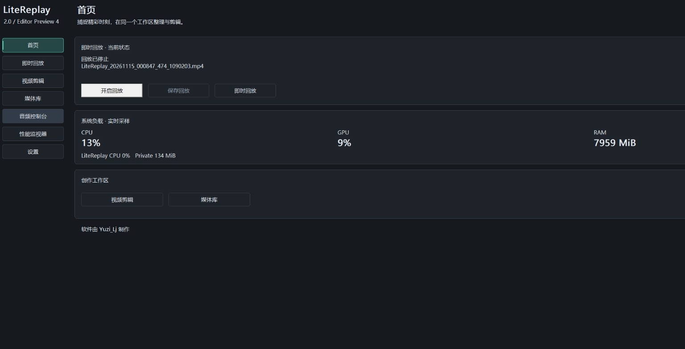
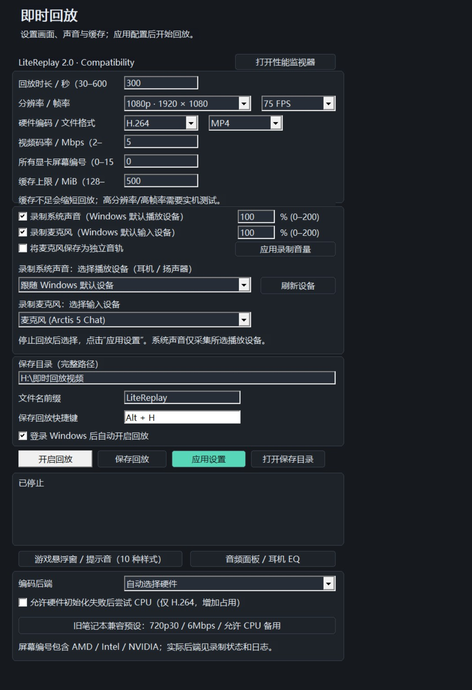
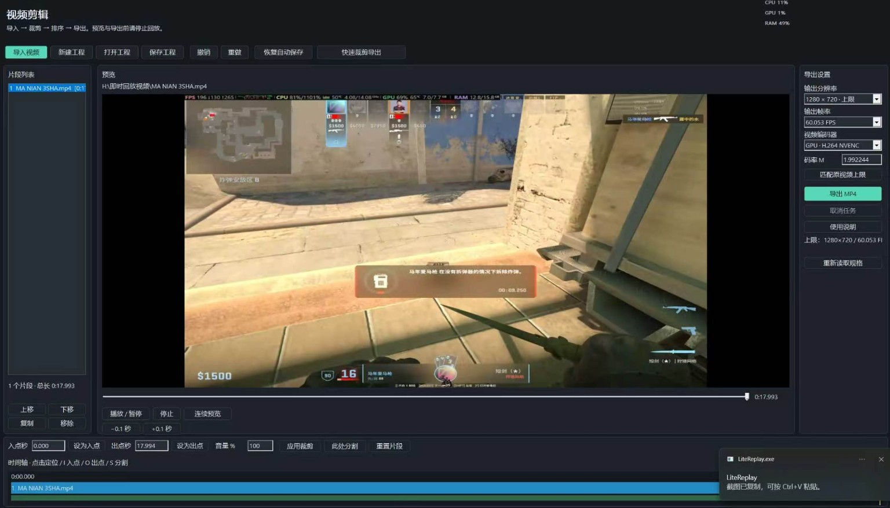
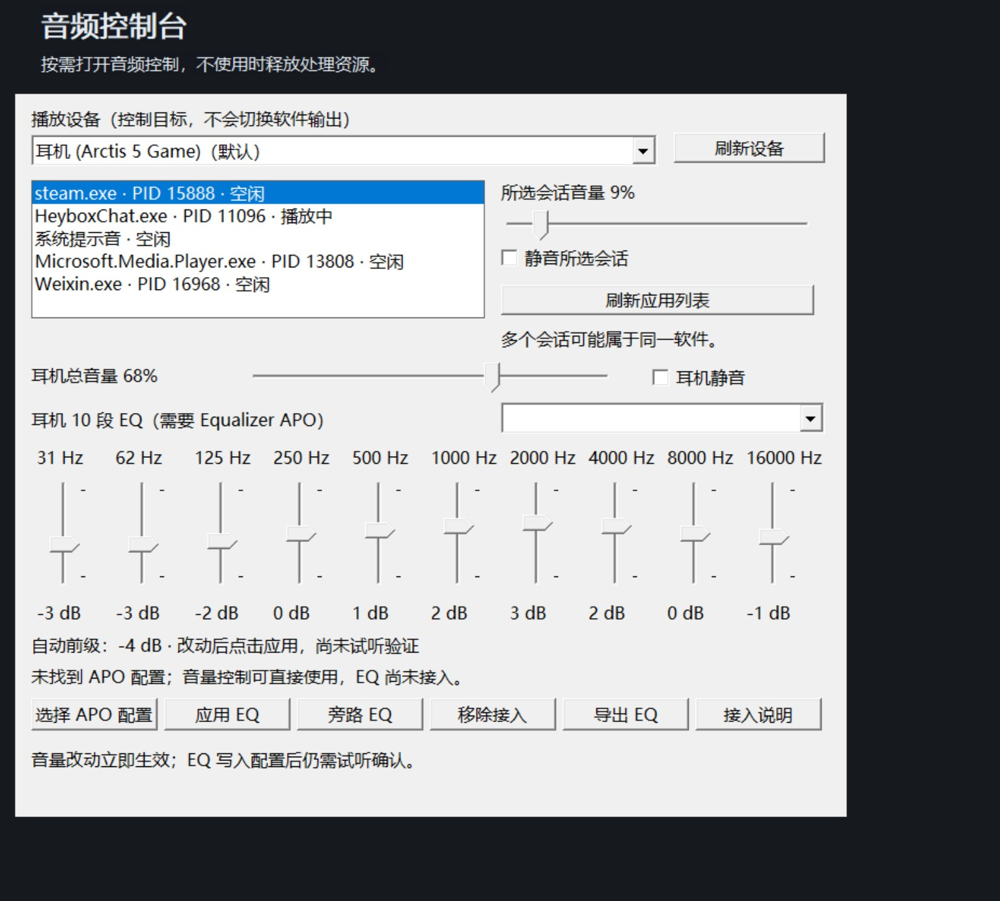
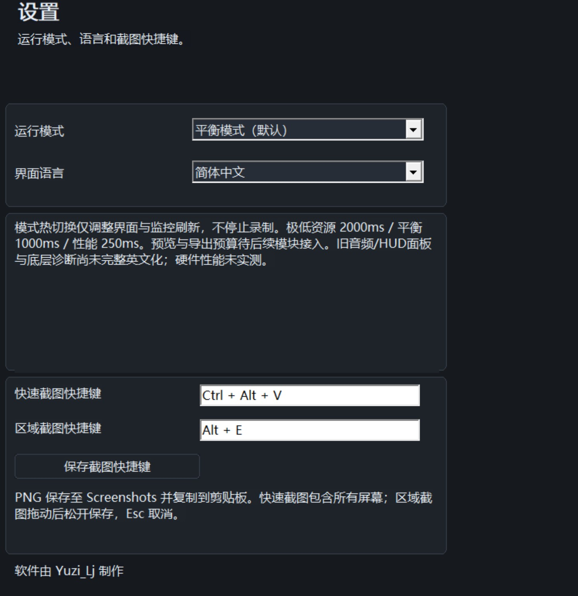
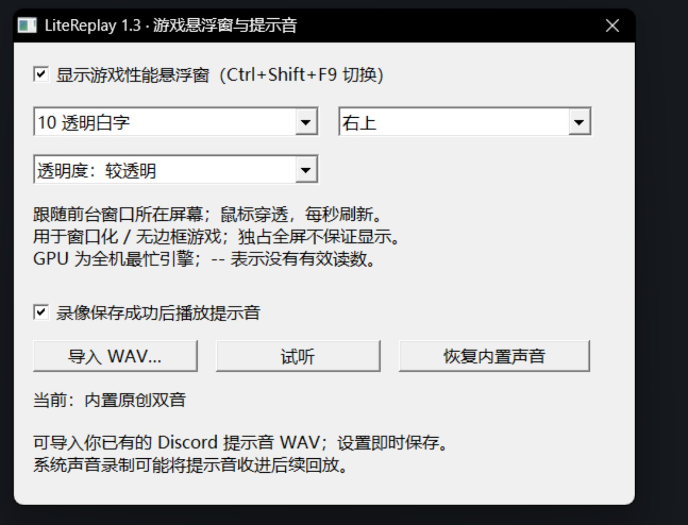

# LiteReplay

**捕捉精彩时刻，在同一个工作区整理与剪辑。**  
*A lightweight gaming replay and multimedia workspace for Windows.*

LiteReplay 是一款面向 Windows 的轻量化游戏即时回放与多媒体工具。它将即时回放、视频剪辑、媒体库、音频控制和性能监视整合在同一个桌面工作区中。

> 当前展示版本：**LiteReplay 2.0 · Editor Preview 4**  
> 平台：Windows x64 · 许可证：MIT

[下载 LiteReplay 2.0 Editor Preview 4](https://github.com/MikaW21/LiteReplay/releases/download/v2.0.0-editor-preview.4/LiteReplay-2.0-Editor4.zip) · [查看全部 Releases](https://github.com/MikaW21/LiteReplay/releases)

---

## 界面预览

### 首页

首页集中显示即时回放状态、最近录制文件和系统负载，并提供进入剪辑与媒体库的快捷入口。

### 即时回放

可配置回放时长、分辨率、帧率、编码格式、码率与缓存上限；支持选择系统声音和麦克风输入设备，并分别调整录制音量。还可设置保存目录、文件名前缀、保存快捷键和登录 Windows 后自动启动回放。

### 视频剪辑

在剪辑工作区导入视频、创建或打开工程，使用片段列表、预览窗口和时间轴整理素材。支持设置入点/出点、分割片段、调整片段音量，并从导出面板选择输出分辨率、帧率、编码器和码率。

### 音频控制台

音频控制台提供播放设备选择、应用音量控制与静音操作，并提供耳机总音量和 10 段 EQ 调节入口。EQ 功能需要安装并配置 Equalizer APO；未接入 APO 时，其他可用的音量控制仍可独立使用。

### 设置与性能选项

设置页面提供运行模式、界面语言和截图快捷键配置。界面展示平衡、极低资源与性能等运行模式；不同模式的实际表现会受设备和系统环境影响。

### 游戏悬浮窗与提示音

可启用游戏性能悬浮窗，选择预设样式、位置和透明度；录制保存成功后可播放提示音，也支持导入 WAV 音频。

---

## 主要功能

| 模块 | 功能 |
|---|---|
| 即时回放 | 设置回放时长、分辨率、帧率、编码格式、码率与缓存上限 |
| 音频录制 | 选择系统播放设备与麦克风，调整录制音量，可将麦克风保存为独立音轨 |
| 媒体库 | 集中查看和管理录制素材 |
| 视频剪辑 | 导入素材、工程管理、时间轴剪辑、片段分割、音量调整与导出 |
| 音频控制台 | 应用音量与静音控制、播放设备选择、耳机音量及 EQ 入口 |
| 性能监视 | 查看 CPU、GPU、RAM 等系统负载信息 |
| 游戏悬浮窗 | 多种显示样式、位置与透明度设置 |
| 截图 | 快速截图与区域截图快捷键设置 |
| 运行模式 | 平衡、极低资源、性能模式 |

具体可用选项以软件界面和当前设备支持情况为准。

## 下载与运行

1. 前往 [LiteReplay 2.0 Editor Preview 4 Release](https://github.com/MikaW21/LiteReplay/releases/tag/v2.0.0-editor-preview.4)。
2. 下载 `LiteReplay-2.0-Editor4.zip`。
3. 将压缩包**完整解压到一个独立文件夹**。
4. 运行 `bin/windows-x64/LiteReplay.exe`。

**不要只单独复制 EXE 文件。** 请保留压缩包中的目录结构和运行依赖文件。

## 兼容性与注意事项

- 当前发布包面向 **Windows x64**。
- 编码器、显卡采集和音频设备选项会因硬件、驱动及 Windows 配置而异。
- AMD、Intel、NVIDIA 设备的实际录制能力需要结合本机环境验证。
- Equalizer APO 是耳机 EQ 功能的外部依赖；未配置时 EQ 不会生效。
- 高分辨率、高帧率和较长缓存会增加资源与存储需求，请根据设备能力调整。
- 目前版本仍属于 **Preview**。不同 Windows 版本、DPI 缩放、录制设备和导出场景仍可能存在兼容性差异。遇到问题时，请在提交反馈时附上系统版本、硬件、设置和错误信息。

## 反馈与参与

欢迎通过 GitHub 提交 Bug、功能建议或改进。

- [提交 Issue](https://github.com/MikaW21/LiteReplay/issues)
- [查看源码](https://github.com/MikaW21/LiteReplay)
- [查看发布版本](https://github.com/MikaW21/LiteReplay/releases)

提交问题时，建议附上复现步骤、Windows 版本、CPU/GPU 型号、LiteReplay 设置截图及相关日志。请勿上传包含个人隐私的录屏或日志。

## 开源与致谢

LiteReplay 采用 **MIT License**。请查看仓库中的 `LICENSE` 文件了解许可条款。

项目由 **Yuzi_Lj** 制作，开发过程中部分工作使用 AI 辅助完成。项目功能、代码与发布内容由项目维护者整理和发布。

---

**LiteReplay — Less Resources. More Moments.**
